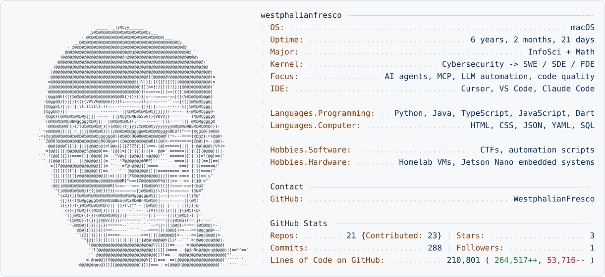
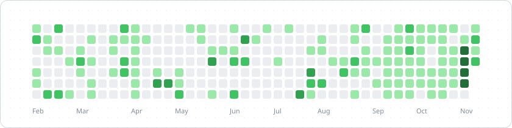
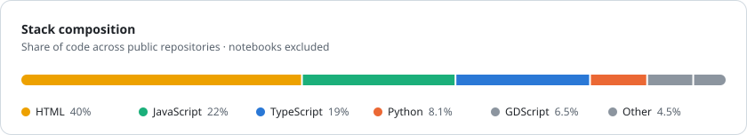
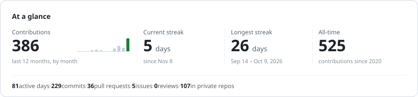
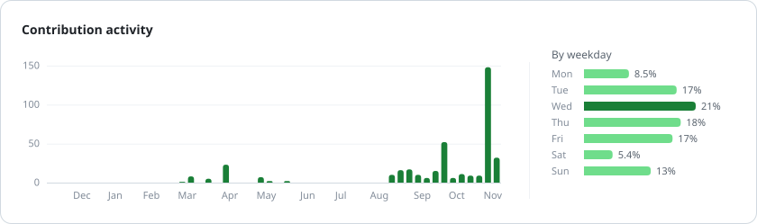
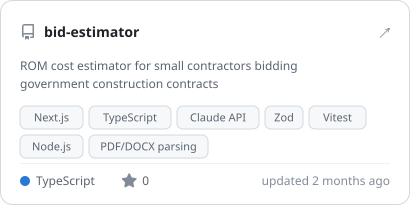
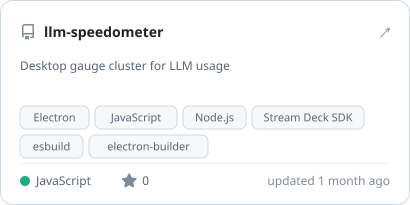
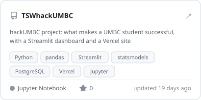
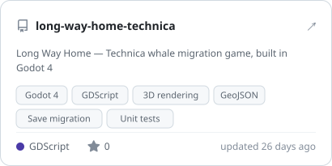

<!-- Cards in assets/ are rendered by scripts/build.mjs (portrait from scripts/portrait.py) and refreshed daily by .github/workflows/profile-cards.yml -->

<picture>
  <source media="(prefers-color-scheme: dark)" srcset="assets/terminal-dark.svg">
  
</picture>

<picture>
  <source media="(prefers-color-scheme: dark)" srcset="assets/hero-dark.svg">
  
</picture>

<picture>
  <source media="(prefers-color-scheme: dark)" srcset="assets/languages-dark.svg">
  
</picture>

<picture>
  <source media="(prefers-color-scheme: dark)" srcset="assets/overview-dark.svg">
  
</picture>

<picture>
  <source media="(prefers-color-scheme: dark)" srcset="assets/activity-dark.svg">
  
</picture>

<a href="https://github.com/WestphalianFresco/bid-estimator"><picture><source media="(prefers-color-scheme: dark)" srcset="assets/project-bid-estimator-dark.svg"></picture></a> <a href="https://github.com/WestphalianFresco/llm-speedometer"><picture><source media="(prefers-color-scheme: dark)" srcset="assets/project-llm-speedometer-dark.svg"></picture></a> <a href="https://github.com/WestphalianFresco/TSWhackUMBC"><picture><source media="(prefers-color-scheme: dark)" srcset="assets/project-TSWhackUMBC-dark.svg"></picture></a> <a href="https://github.com/WestphalianFresco/long-way-home-technica"><picture><source media="(prefers-color-scheme: dark)" srcset="assets/project-long-way-home-technica-dark.svg"></picture></a>

